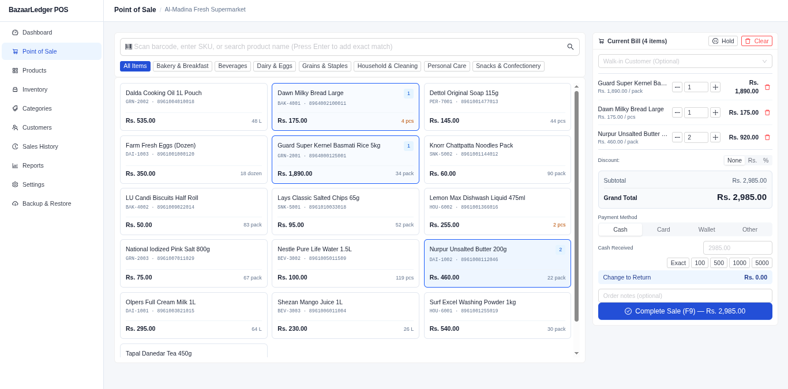

# BazaarLedger

**A modern business management and ledger platform designed to simplify daily operations, sales tracking, and financial record management.**

BazaarLedger is a web-based application built with modern technologies to provide a streamlined interface for managing business workflows, organizing records, and monitoring business activity.

---

## Features

- **Business Dashboard** — Centralized overview of business activity and important information.
- **Ledger Management** — Organize and maintain business transaction records.
- **Business Operations** — Simplify everyday business management workflows.
- **Data Visualization** — Present business information in a clear and organized way.
- **Local Database** — SQLite-powered data storage.
- **Responsive UI** — Modern interface designed for a smooth user experience.
- **Data Management** — Structured data handling with client-side state and query management.
- **Modular Architecture** — Separate frontend, backend, shared logic, and testing structure.

---

## Tech Stack

### Frontend

- React 19
- TypeScript
- Vite 8
- Ant Design 6
- Tailwind CSS 4
- React Router 7
- Zustand
- TanStack React Query
- Lucide React
- Motion

### Backend

- Node.js
- Express.js
- TypeScript
- SQLite
- better-sqlite3
- Zod

### Testing & Tooling

- Vitest
- Testing Library
- Supertest
- TypeScript
- Bun lockfile

---

## Project Structure

```text
BazaarLedger/
├── backend/
│   └── src/              # Backend application logic
├── docs/                 # Project documentation
├── shared/               # Shared modules and types
├── src/                  # Frontend source code
├── tests/                # Test files
├── server.ts             # Development server entry point
├── index.html
├── package.json
├── vite.config.ts
├── vitest.config.ts
├── tsconfig.json
└── README.md
```

---

## Getting Started

### Prerequisites

Make sure you have installed:

- Node.js
- npm
- Git

### 1. Clone the Repository

```bash
git clone https://github.com/raheen-fatima/bazaarledger.git
```

### 2. Navigate to the Project

```bash
cd bazaarledger
```

### 3. Install Dependencies

```bash
npm install
```

If npm reports an `esbuild` dependency conflict with Vite 8, update the esbuild development dependency:

```bash
npm install -D esbuild@^0.28.0
```

Then run `npm install` again.

### 4. Start the Development Server

```bash
npm run dev
```

Open the local URL displayed in your terminal.

---

## Available Scripts

| Command           | Description                          |
| ----------------- | ------------------------------------ |
| `npm run dev`     | Start the development server         |
| `npm run build`   | Build the application for production |
| `npm run preview` | Preview the production build         |
| `npm run lint`    | Run TypeScript checks                |
| `npm test`        | Run the test suite                   |
| `npm run clean`   | Remove generated build/server files  |

---

## Production Build

Build the application for production:

```bash
npm run build
```

Preview the production build locally:

```bash
npm run preview
```

---

## Testing

Run the project's tests using Vitest:

```bash
npm test
```

Testing technologies include:

- Vitest
- React Testing Library
- Jest DOM
- Supertest

---

## Database

BazaarLedger uses **SQLite** with `better-sqlite3` for local database operations.

SQLite provides lightweight, persistent storage without requiring a separate database server, making it suitable for local or small-scale business applications.

---

## Configuration

If the application requires environment variables, create a `.env` file in the project root and configure the required values.

Never commit private credentials, API keys, or sensitive configuration files to GitHub.

---

## Roadmap

- [ ] Improve business analytics and reporting
- [ ] Expand ledger and transaction management
- [ ] Add additional data export options
- [ ] Improve validation and error handling
- [ ] Expand automated test coverage
- [ ] Enhance production deployment support

---

## Contributing

Contributions, suggestions, and bug reports are welcome.

1. Fork the repository.
2. Create a feature branch.
3. Commit your changes.
4. Push your branch.
5. Open a Pull Request.

---

## Author

**Raheen Fatima**

GitHub: [@raheen-fatima](https://github.com/raheen-fatima)

---

## License

Please check the repository's license file for usage and distribution permissions.

---

<p align="center">   Built with React, TypeScript, and Node.js </p>
